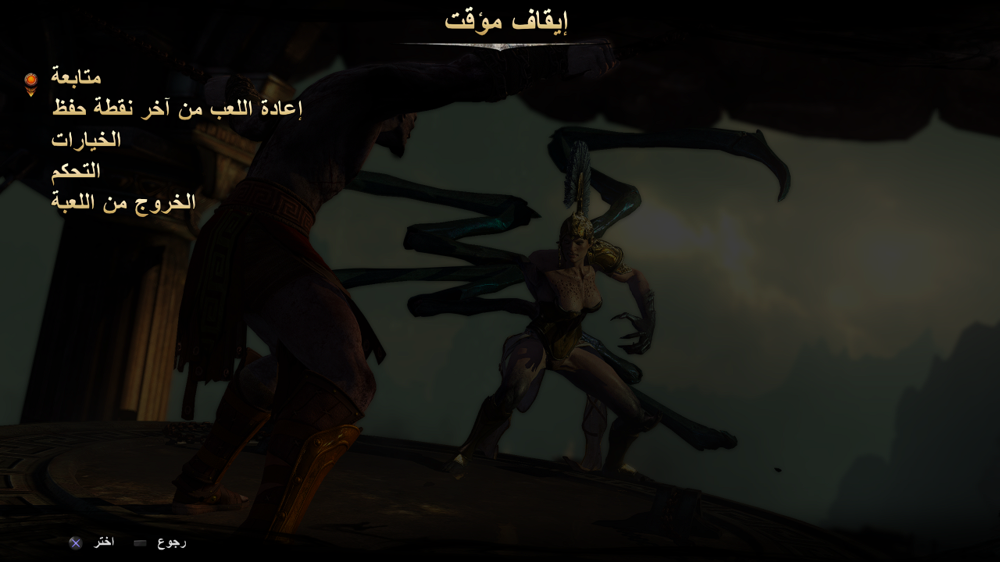

# تعريب God of War: Ascension

تعريب نصوص القصة والمراحل والقوائم والإرشادات للنسخة الأوروبية **BCES01741 إصدار 1.00** على مشروع [GoW-Ascension-Recomp](https://github.com/bc160201983/GoW-Ascension-Recomp).

يشمل التعريب الحوارات وأسماء الفصول الثلاثين وإرشادات اللعب وأوصاف العناصر والنصوص الإضافية. تمت مراجعة حوار القصة يدوياً، واستُخدمت ترجمة آلية محلية لبعض النصوص الأخرى. أكد اللاعب ظهور التعريب في نسخته. قد تظهر أخطاء لغوية أو مشاكل في العرض خلال المراحل المختلفة.

## تحديث 1.2.0

يستخدم التحديث خط Noto Sans Arabic وترميزاً متوافقاً مع المشغّل لمعالجة اختفاء النصوص وتحسين عرض الحروف. خُفّض حجم الخط داخل اللعبة، وتحققنا من ظهور القوائم وتحميل حفظ الفصل 14 وإعادة آخر نقطة حفظ.

## المتطلبات

- نظام Windows ونسخة لعبة God of War: Ascension الأوروبية BCES01741 إصدار 1.00.
- تثبيت GoW-Ascension-Recomp وإعداد اللعبة في المشغّل.
- ملف التعريب المضغوط [تنزيل التعريب 1.2.0](https://github.com/ccvv9c-ui/god-of-war-ascension-arabic/raw/refs/heads/main/arabic-full-text.zip).

## التثبيت

1. أغلق اللعبة، ثم نزّل ملف التعريب المضغوط وافتحه.
2. افتح مشغّل اللعبة، ثم افتح صفحة **Mods** وحدد مسار **Mods folder** الظاهر فيها.
3. انسخ مجلد `arabic-story-preview` الموجود داخل الملف المضغوط إلى مجلد المودات. يجب أن يحتوي المجلد المنسوخ مباشرة على الملفات `GAME.PSARC` و`TPPS.PSARC` و`mod.json`.
4. ارجع إلى صفحة **Mods** واضغط **Refresh**، ثم فعّل **Arabic – Full Text**.
5. من إعدادات المشغّل، اختر **English (UK)** في **Game language** وفعّل **Subtitles**.
6. شغّل اللعبة. يبقى الصوت باللغة الإنجليزية حسب إعداد الصوت.

إذا كانت لديك نسخة تجريبية سابقة من التعريب، استبدل مجلدها بالمجلد الجديد بعد الاحتفاظ بنسخة منه.

## إزالة التعريب

أزل علامة التفعيل من **Arabic – Full Text** في صفحة **Mods**، ثم شغّل اللعبة. يمكنك حذف مجلد المود من مجلد المودات إذا لم تعد تحتاجه.

## التوافق والملاحظات

صُمم هذا الإصدار لـ BCES01741 إصدار 1.00. لم يُتحقق من توافقه مع الإصدارات الأخرى أو مع مودات أخرى تعدّل حزم اللعبة نفسها. اذكر رقم إصدار اللعبة ووصف المشكلة وصورة لها عند الإبلاغ عن خطأ.

اللعبة وعلاماتها التجارية تعود لأصحابها. هذا مشروع تعريب من المجتمع.
